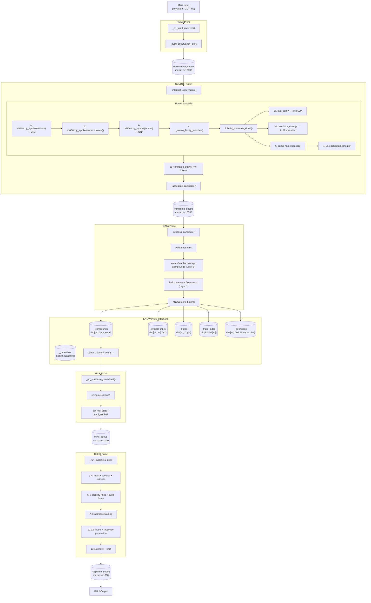

# PABLO Data Flow — Implemented Pipeline (Phase 1)

Complete map of how data moves through the system: what shape it takes at each stage,
which queues carry it, and what transformations occur.

---

## Overview: Pipeline Stages

```
User Input
    │
    ▼
READ ──────────────── emits observation_dict
    │ observation_queue (maxsize=10000)
    ▼
SYMBOL ─────────────── router cascade + activation cloud
    │ candidate_queue (maxsize=10000)
    ▼
DATA ───────────────── validates + creates Compounds
    │ KNOW.store_batch()
    ▼
KNOW ───────────────── stores Compounds + Triples + Narratives
    │ Layer 1 commit event → SELF listener
    ▼
SELF ───────────────── computes salience + feel state
    │ think_queue (maxsize=1000)
    ▼
THINK ──────────────── 15-step reasoning cycle
    │ response_queue (maxsize=1000)
    ▼
GUI / Output
```

---

## Full Pipeline Mermaid Diagram



---

## Stage 1 — READ: User Input → observation_queue

**Source:** `primes/READ.py :: _build_observation_dict()`

```python
{
    "timestamp":  float,          # time.time()
    "modality":   "READ",
    "event_type": str,            # "line_entered" | "text_appeared" | "file_appended"
    "data": {
        "text":               str,       # raw input: "the cat moved left"
        "preliminary_tokens": list[str], # ["the", "cat", "moved", "left"]
        "token_count":        int,       # 4
    },
    "metadata": {
        "source": str,   # "keyboard" | "screen" | "file" | "simulation" | "consultation"
        "prime":  "READ",
        "mode":   str,   # "autonomous" | "consultation"
    },
}
```

---

## Stage 2 — SYMBOL: observation → candidate (via Router cascade)

### 2a. Router Resolution Cascade

For each spaCy-analyzed token, the Router tries these steps in order:

| Step | Method   | Description                              | Score |
|------|----------|------------------------------------------|-------|
| 1    | know_exact      | `KNOW.by_symbol(surface)` — O(1)        | 1.0   |
| 2    | know_exact      | `KNOW.by_symbol(surface.lower())` — O(1)| 1.0   |
| 3    | know_lemma      | `KNOW.by_symbol(lemma)` — O(1)          | —     |
| 4    | family_member   | create inflected form compound           | 0.95  |
| 5    | activation_cloud| build cloud → fast_path or specialist    | 0.7+  |
| 6    | heuristic       | surface form is a prime name             | 1.0   |
| 7    | unresolved      | placeholder                              | 0.0   |

### 2b. ActivationCloud (built at Step 5)

**Source:** `core/activation_cloud.py`

Built once per token before the LLM specialist is called.
All KNOW lookups are read-only. Not stored. Discarded after specialist call.

```python
ActivationCloud(
    # Identity
    token:    str,         # "cat"
    position: int,         # 1
    lemma:    str | None,  # "cat"
    pos:      str | None,  # "NOUN"

    # Cognitive layer (Phase 1)
    exact_match:          Compound | None,  # existing compound or None
    family_root:          Compound | None,  # root form if inflected
    definition_compounds: list[Compound],   # up to 10 nested concept compounds
    utterance_context:    list[Compound],   # compounds already resolved earlier in utterance
    narrative_context:    list[Compound],   # last 5 recent concept/utterance compounds from KNOW
    prime_candidates:     dict[str, float], # prime_name → max activation weight
    fast_path:            bool,             # True if exact_match.confidence >= 0.8

    # Dormant layers (Phase 2–4, all None in Phase 1)
    affective_valence:   None,
    affective_intensity: None,
    goal_relevance:      None,
    need_pressure:       None,
    source_salience:     None,
    narrative_status:    None,
)
```

**Prime activation weights (max-wins aggregation):**

| Source              | Weight |
|---------------------|--------|
| exact_match         | 1.0    |
| family_root         | 0.9    |
| definition_compound | 0.6    |
| utterance_context   | 0.5    |
| narrative_context   | 0.3    |

**fast_path check:** If `cloud.exact_match.confidence >= 0.8` → skip LLM, return
existing compound immediately. Stats: `router.stats.fast_path_skips += 1`.

### 2c. TokenResolution (output of each cascade step)

**Source:** `core/router.py :: TokenResolution`

```python
TokenResolution(
    token:             str,         # "moved"
    prime:             str | None,  # "MOVE" (if resolved to prime) or None (if compound found)
    score:             float,       # 0.0–1.0
    position:          int,         # 2
    method:            str,         # "family_member"
    compound_id:       int | None,  # 452 — existing/new compound ID
    lemma:             str | None,  # "move"
    pos:               str | None,  # "VERB"
    grammatical_primes: set[str],   # {"DO", "CAUSE"}
    is_family_member:  bool,        # True
    family_root_id:    int | None,  # 451
)
```

### 2d. Candidate dict (SYMBOL → candidate_queue)

**Source:** `primes/SYMBOL.py :: _assemble_candidate()`

```python
{
    "candidate_primes": [
        # one entry per token, from TokenResolution.to_candidate_entry()
        {
            "token":             str,        # "moved"
            "prime":             str | None, # "MOVE"
            "score":             float,      # 0.8
            "position":          int,        # 2
            "method":            str,        # "family_member"
            # optional keys only if set:
            "compound_id":       int,        # 452
            "lemma":             str,        # "move"
            "pos":               str,        # "VERB"
            "grammatical_primes": list[str], # ["DO", "CAUSE"]
            "is_family_member":  bool,       # True
            "family_root_id":    int,        # 451
        },
        # ... one per token
    ],
    "roles":         list,          # [] (Phase 2)
    "rule_template": None,          # None (Phase 2)
    "confidence":    float,         # average score across tokens
    "provenance":    {
        "model":   str,             # "router"
        "adapter": None,
    },
    "raw_input":      str,          # "the cat moved left"
    "observation_id": str,          # "obs_1709509200123"
    "source":         str,          # "keyboard"
}
```

---

## Stage 3 — DATA: candidate → Compounds → KNOW

**Source:** `primes/DATA.py :: _process_candidate()`

DATA reads from candidate_queue and:
1. Validates each prime name against `PRIME_INDEX`
2. Detects logic compound references
3. Creates or resolves concept Compounds (Layer 0) for each grounded token
4. Builds an utterance Compound (Layer 1) containing all concept IDs
5. Calls `KNOW.store_batch([...all concepts..., utterance])`

**Layer 0 — Concept Compound:**

```python
Compound(
    id:                         int,         # temp = negative; KNOW assigns permanent (200+)
    symbol:                     str,         # "move" (lemmatized) or surface form
    primebit:                   PrimeBit,    # 64-bit bitmask encoding prime indices
    nested:                     list[int],   # [] for bare concept compounds
    relations:                  list[Relation], # []
    definition_narrative_id:    int | None,  # assigned by KNOW after store
    grounded:                   bool,        # True if score >= 0.6
    version:                    int,         # 0
    confidence:                 float,       # router score (0.0–1.0)
    candidate_interpretations:  list[dict],  # alternatives from router
    compound_type:              "concept",
    created_at:                 float,
)
```

**Layer 1 — Utterance Compound:**

```python
Compound(
    id:           int,           # temp = negative; KNOW assigns permanent
    symbol:       str,           # "the cat moved left" (raw_input)
    primebit:     PrimeBit,      # union of all nested concept primebits
    nested:       list[int],     # [concept_id_1, concept_id_2, ...]
    relations:    list[Relation],# []
    grounded:     bool,          # True
    confidence:   float,         # 1.0
    compound_type:"utterance",
    provenance_data: {
        "source":         str,   # "keyboard"
        "observation_id": str,   # "obs_1709509200123"
    },
)
```

**candidate_interpretations entry shape:**

```python
[
    {"prime": str, "score": float},          # primary grounding
    {"grammatical_primes": list[str]},        # if morphological primes present
    {"pos": str},                             # if POS available
    {"method": str},                          # router resolution method
    {"surface_form": str, "lemma": str},      # if lemmatized
]
```

---

## Stage 4 — KNOW: Storage Layer

**Source:** `primes/KNOW.py`

KNOW maintains five in-memory stores with separate RLocks:

### _compounds (+ _symbol_index)

```
_compounds:     dict[int, Compound]     # compound_id → Compound
_symbol_index:  dict[str, int]          # symbol_str → compound_id  (O(1) by_symbol)

ID ranges:
  0–99    reserved
  100–199 logic compounds (pre-loaded from core/logic_compounds.json)
  200+    runtime compounds (concept, utterance, intent)
```

### _triples (+ _triple_index)

```
_triples:       dict[int, Triple]       # triple_id → Triple
_triple_index:  dict[int, list[int]]    # source_id → [triple_id, ...]
```

**Triple shape:**

```python
Triple(
    id:             int,
    source_id:      int,          # left-hand compound ID
    predicate:      str,          # one of 63 primes: "KIND", "FROM", "BE", "WITH", etc.
    target_id:      int | None,   # right-hand compound ID   ┐ exactly one
    target_prime:   str | None,   # prime name as terminal   ┘ is set
    confidence:     float,        # 0.0–1.0
    source:         str,          # "definition"|"utterance"|"inferred"|"specialist"|"manual"
    observation_id: str | None,   # Phase 1 grouping key
    created_at:     float,
)
```

### _definitions

```
_definitions: dict[int, DefinitionNarrative]
```

Created automatically for every concept compound stored via `store_batch()`.
Records primebit, relations, and confidence at each refinement step (full history).

### _narratives

```
_narratives: dict[int, Narrative]
```

Relational narrative ("relationship_user_primary") bootstrapped on first run.
Episodic narratives created by THINK as utterances are processed.

### Persistence (storage/ directory)

| File                    | Contents                            |
|-------------------------|-------------------------------------|
| storage/compounds.json  | all runtime compounds (id >= 200)   |
| storage/definitions.json| all DefinitionNarratives            |
| storage/narratives.json | all non-archived Narratives         |
| storage/refinement.json | RefinementRecord per compound       |
| storage/triples.json    | all Triples                         |
| storage/metadata.json   | next_id, next_def_id, next_nar_id, next_triple_id |

Autosaved every 30 seconds on background thread.

---

## Stage 5 — SELF: KNOW commit → think_queue

**Source:** `primes/SELF.py :: _on_utterance_committed()`

Registered as a Layer 1 commit listener on KNOW.
Fires when KNOW stores a compound with `compound_type="utterance"`.

```python
{
    "utterance_compound_id": int,    # Layer 1 compound ID just stored
    "timestamp":             float,  # time.time()
    "source":                str,    # "keyboard" | "gui" | "stdin" | "vision" | "audio" | "internal"
    "salience":              float,  # computed 0.0–1.0
    "want_context":          str,    # active WANT goal binding name or "default"
    "feel_state":            str,    # "warm" | "neutral" | "guarded" | "closed"
}
```

**Salience base values by source:**

| Source   | Base salience |
|----------|---------------|
| keyboard | 1.0           |
| gui      | 1.0           |
| stdin    | 1.0           |
| vision   | 0.4           |
| audio    | 0.4           |
| internal | 0.2           |

Modulated by active WANT goal and FEEL state multipliers.
Items below `ATTENTION_THRESHOLD = 0.3` are dropped (not enqueued).

---

## Stage 6 — THINK: think_queue → response_queue

**Source:** `primes/THINK.py :: _run_cycle()`

THINK runs a 15-step reasoning cycle per utterance:

| Steps | What happens                                                  |
|-------|---------------------------------------------------------------|
| 1–4   | fetch utterance from KNOW, validate, activate binding web     |
| 5–6   | classify semantic roles (agent, patient, action, modifier)    |
| 7–9   | build utterance frame, create/update narrative bindings       |
| 10–12 | create Layer 2 intent Compound, generate response text        |
| 13–15 | store intent to KNOW, record usage, emit to response_queue   |

**Response dict (→ response_queue):**

```python
{
    "timestamp":   float,   # time.time()
    "type":        "response",
    "text":        str,     # generated response text
    "compound_id": int,     # Layer 2 intent compound ID
    "source":      str,     # original utterance source ("keyboard", etc.)
    "frame":       {
        "subject":    str | None,   # binding name
        "predicate":  str | None,   # binding name
        "object":     str | None,   # binding name
        "auxiliary":  list[str],
        "modifiers":  list[str],
        "spatial":    list[str],
        "temporal":   list[str],
        "unresolved": list[str],
    },
}
```

---

## Data Transformation Summary

```
Raw text: "the cat moved left"
    │
    ▼ READ
observation_dict.data.text = "the cat moved left"
observation_dict.data.preliminary_tokens = ["the", "cat", "moved", "left"]
    │
    ▼ SYMBOL / Router
TokenResolution(token="the",   prime=None,   score=0.0, method="unresolved",     compound_id=None)
TokenResolution(token="cat",   prime=None,   score=1.0, method="know_exact",     compound_id=201)
TokenResolution(token="moved", prime="MOVE", score=0.8, method="family_member",  compound_id=452)
TokenResolution(token="left",  prime="LEFT", score=1.0, method="heuristic",      compound_id=None)
    │
    ▼ to_candidate_entry() × 4
candidate["candidate_primes"] = [
    {"token":"the",   "prime":None,   "score":0.0, "method":"unresolved"},
    {"token":"cat",   "prime":None,   "score":1.0, "method":"know_exact",    "compound_id":201},
    {"token":"moved", "prime":"MOVE", "score":0.8, "method":"family_member", "compound_id":452},
    {"token":"left",  "prime":"LEFT", "score":1.0, "method":"heuristic"},
]
    │
    ▼ DATA
Layer 0 concepts: [Compound(symbol="cat", primebit={BODY,LIFE,...}),
                   Compound(symbol="moved", primebit={MOVE,DO,...}),
                   Compound(symbol="left",  primebit={LEFT,...})]
Layer 1 utterance: Compound(symbol="the cat moved left",
                             primebit=BODY|LIFE|MOVE|DO|LEFT,
                             nested=[201, 452, 453])
    │
    ▼ KNOW.store_batch()
Compounds assigned permanent IDs (200+)
symbol_index updated O(1)
DefinitionNarratives created for each concept
Layer 1 commit event fired
    │
    ▼ SELF
think_queue ← {utterance_compound_id: 500, salience: 1.0, feel_state: "neutral", ...}
    │
    ▼ THINK (15-step cycle)
frame: {subject: "THIS_CAT", predicate: "ACT_MOVE", object: "LOC_LEFT"}
response: "I understood 'the cat moved left' — MOVE DO LEFT BODY"
    │
    ▼ response_queue → GUI
```

---

## PrimeBit — The Semantic Substrate

All meaning is ultimately stored as a **PrimeBit**: a 64-bit integer where each bit
position encodes whether one of the 63 primes is active for this compound.

```
Bit index ↔ Prime name  (from core/primebit.py PRIME_INDEX)

Example: "move" compound
  primebit.value = 0b...0001000010000000  (bits for MOVE + DO set)
  primebit.get_prime_names() → ["DO", "MOVE"]

Operations:
  a | b    — union of two primebits (utterance = union of all token primebits)
  a & b    — intersection (used by by_trigger() for trigger matching)
  a == b   — equality check
```

The primebit is how PABLO thinks — not in words, but in combinations of the 63
atomic concepts. All retrieval, matching, and reasoning operates in prime-space.

---

## Compound Type Hierarchy

```
Layer 0 — concept        "cat", "move", "left"
                         created by DATA from candidate tokens
                         grounded = True if score >= 0.6

Layer 0 — logic         IF, AND, OR, NOT, XOR, NAND, NOR, XNOR, TRUE, FALSE
                         loaded from core/logic_compounds.json (IDs 100–199)
                         pre-loaded at KNOW startup, never modified

Layer 1 — utterance      "the cat moved left"
                         created by DATA per observation
                         nested = [concept_id_1, concept_id_2, ...]
                         primebit = union of all nested concept primebits
                         fires Layer 1 commit event → SELF

Layer 2 — intent         generated by THINK
                         stored by THINK.store() (not store_batch)
                         represents PABLO's response intention

Layer 2 — action         executable compounds (Phase 2)
Layer 2 — macro          compound plans (Phase 2)
```

---

## Key Interfaces Between Components

| From   | To     | Channel                | Shape                         |
|--------|--------|------------------------|-------------------------------|
| READ   | SYMBOL | observation_queue      | observation_dict              |
| SYMBOL | DATA   | candidate_queue        | candidate_dict                |
| DATA   | KNOW   | `KNOW.store_batch()`   | list[Compound]                |
| KNOW   | SELF   | Layer 1 commit event   | (compound_id: int, source: str) |
| SELF   | THINK  | think_queue            | salience_dict                 |
| THINK  | GUI    | response_queue         | response_dict                 |
| Router | KNOW   | `KNOW.store_batch()`   | [family_member Compound]      |
| KNOW   | Router | `KNOW.by_symbol()`     | Compound \| None (O(1))       |
| KNOW   | Cloud  | `KNOW.by_id()`         | Compound \| None              |
| THINK  | KNOW   | `KNOW.store()`         | intent Compound               |
| THINK  | KNOW   | `KNOW.refine_definition()` | updated primebit + triples |
